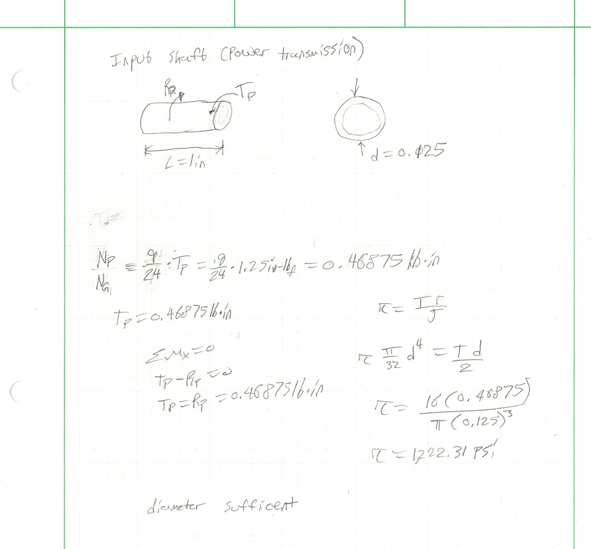
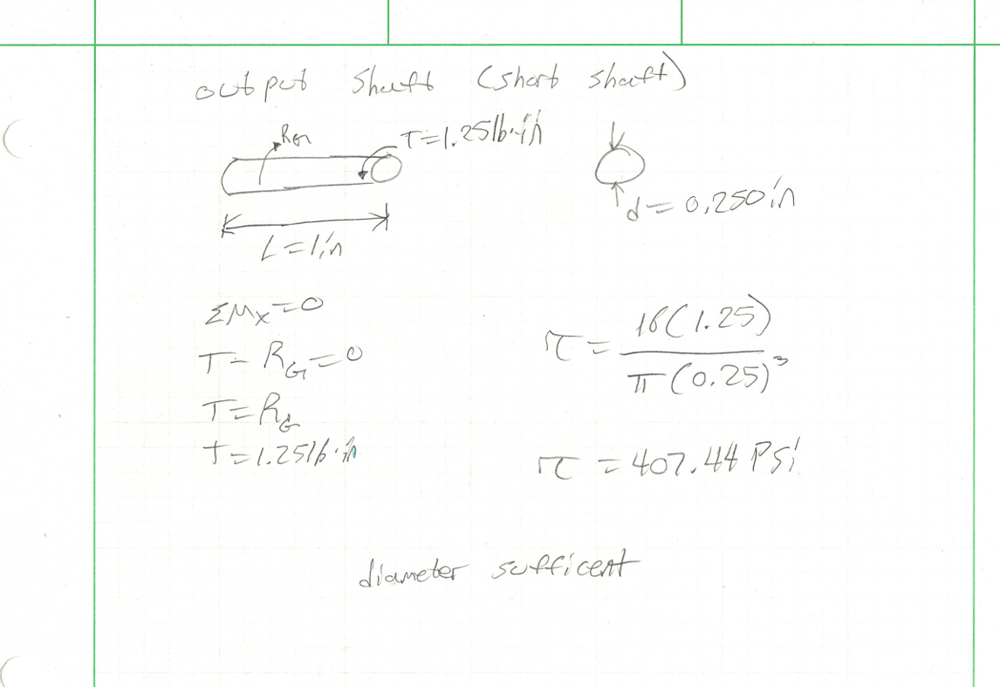
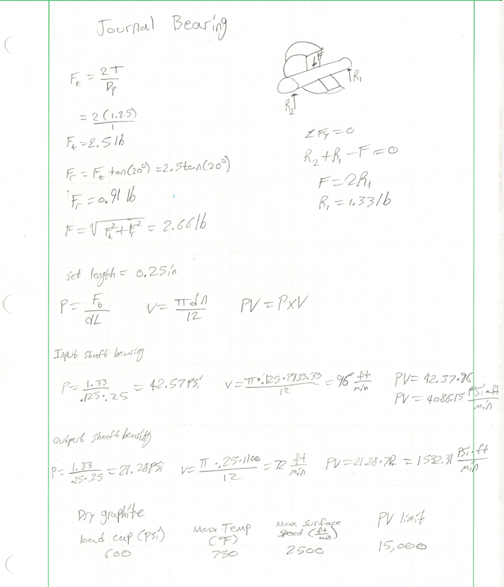
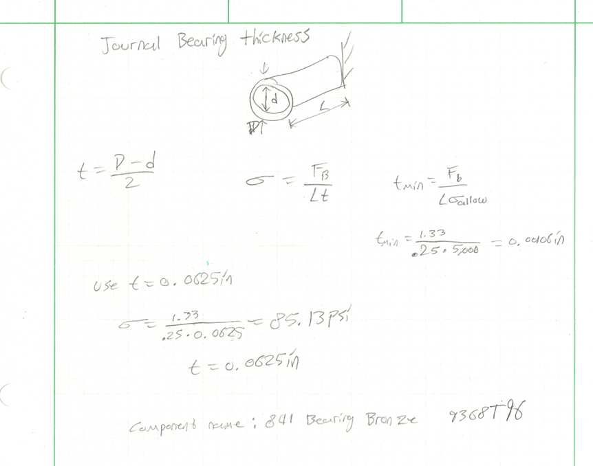
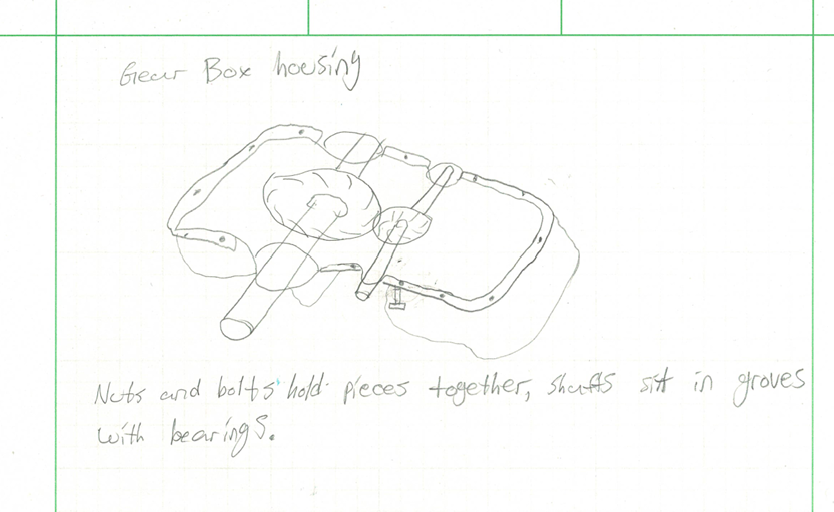
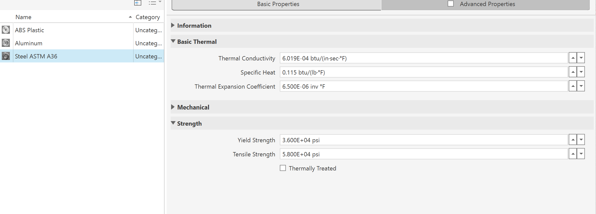
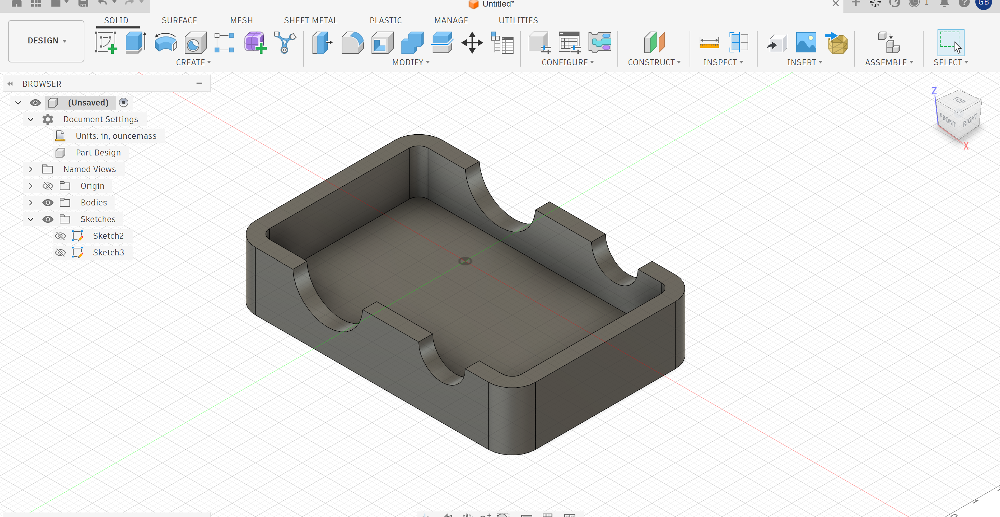
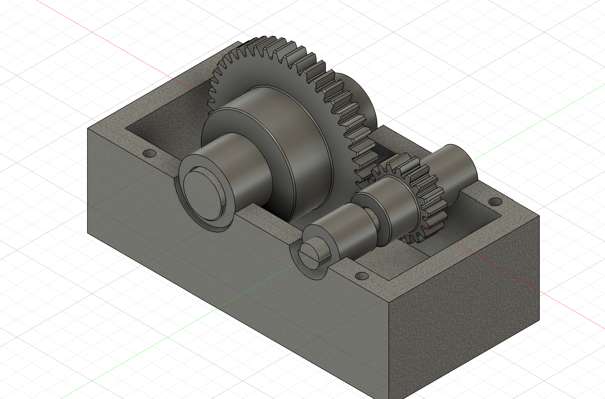

# A8 – Gear Box Design

## Objective
The objective of this assignment is to design a gearbox that is able to be assembled and disassempled. The gear ratio for this assignment is to be 24:9, the output torque will be 1.25 in-lbf, and the input speed will be 1100 rpm. The input shaft diameter is to be 0.125in with the output shaft being 0.25in, additionally each shaft is 1in long.

## Analyze
### Input Shaft
I started with the input shaft with my given parameters, I used the given values and drew a FBD of the shaft. Using the gear ratio I was able to find the torque in the this shaft. I found the torque then I used it to find the shear stress in the shaft due to torsion and I determined I was satisfied with the diameter.

### Output Shaft
Similarly to the Input shaft, I drew a FBD of the output shaft with all knowns. I went ahead just like the previous shaft and found the shear stress due to torsion was 407.44 PSI, which was lower than the input shaft. Overall the diameter was sufficient enough and no changes were neccessary.

### Journal Bearing size and length
The Journal Bearing was much tougher to analze as I had to find the radial and tangential forces before I could determine P and V. I drew the FBD and wrote equations to find each forces and once I found them I was able to write the resultant force from there. Using this force I found both P and V and using the chart from the lecture I decided dry graphite would be good to use given its properties.

### Journal Bearing thickness
A very similar process was used on the journal bearings thickness as was used for the shafts. I was able to draw a free body diagram, then use the force, stress, and length to find the appropriate thickness which the minimum required was very small. As a result I rounded up to 0.0625 in.

## Decide

### Sketch of Gearbox
The sketch of the gear box is not very good to be quite honest. I didn't really know what I had in mind considering that the geometry can get very complex. I decided on a somewhat simple design.

## Communicate

### CAD Model
I modeled the assembly in Fusion, I applied Steel ASTM A36 to the model and I was able to download the correct bearings and gears from the website in the resources. I couldn't remember how to have the gears rotate simultaneously so I just put all the parts together without any motion. I also created a drawing with tolerances for each component of this assignment.

### CAD File
[Download the Gear Box Assembly](./A8.f3z)

### CAD Drawings
[Download the Gear Box Assembly Drawing](./A8 Assembly Drawing.pdf)
[Download the Bearing 1 Drawing](./Bearing 1 Drawing.pdf)
[Download the Bearing 2 Drawing](./Bearing 2 Drawing.pdf)
[Download the Gear 1 Drawing](./Gear 1 Drawing.pdf)
[Download the Gear 2 Drawing](./Gear 2 Drawing.pdf)
[Download the Shaft 1 Drawing](./Shaft1 Drawing.pdf)
[Download the Shaft 2 Drawing](./Shaft2 Drawing.pdf)

