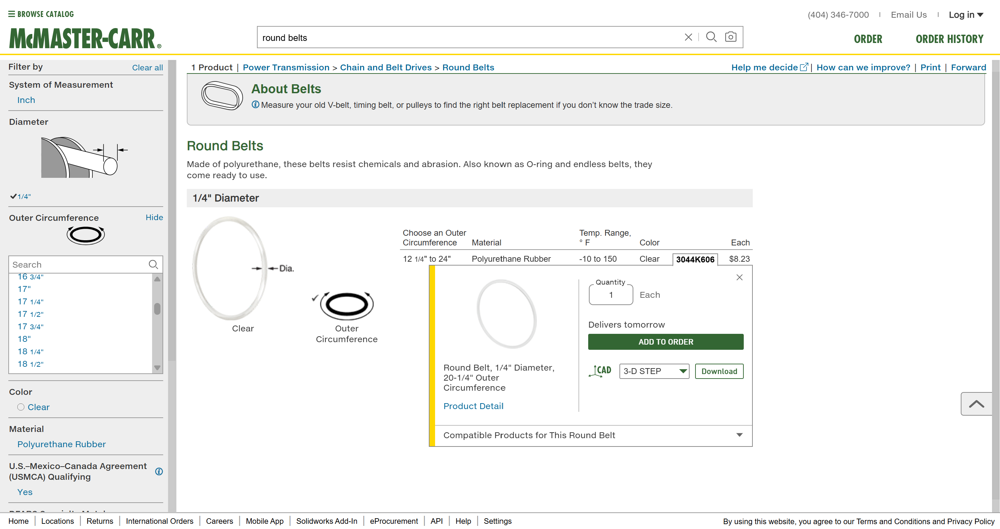
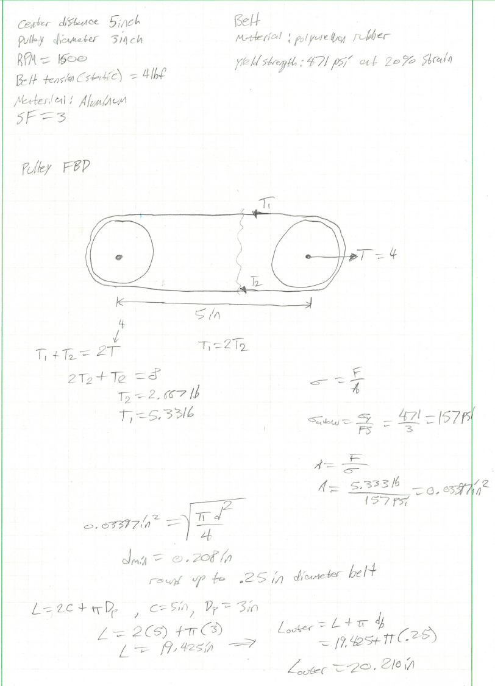
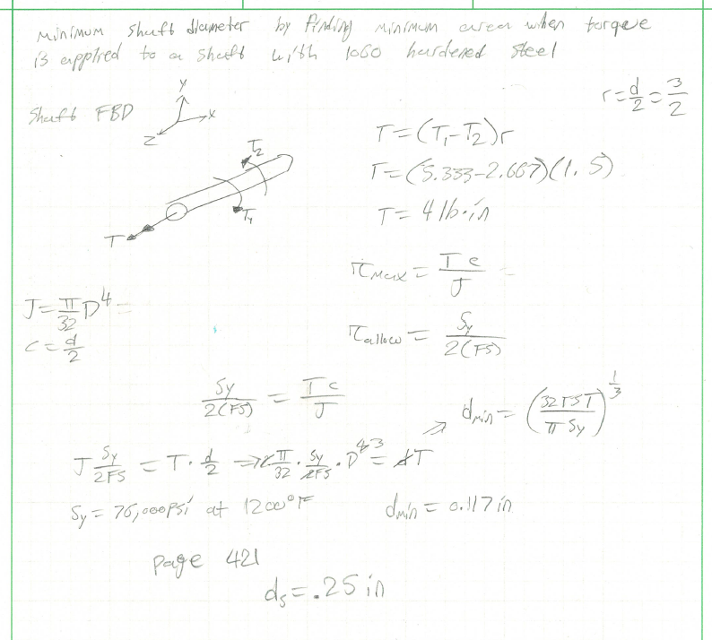
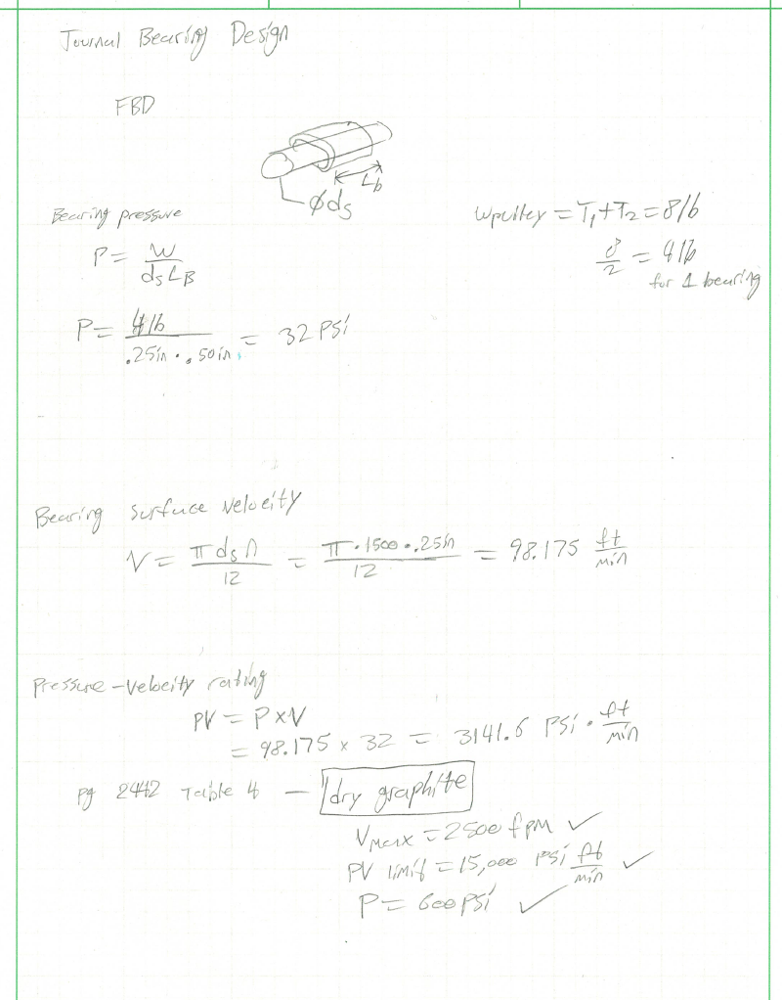
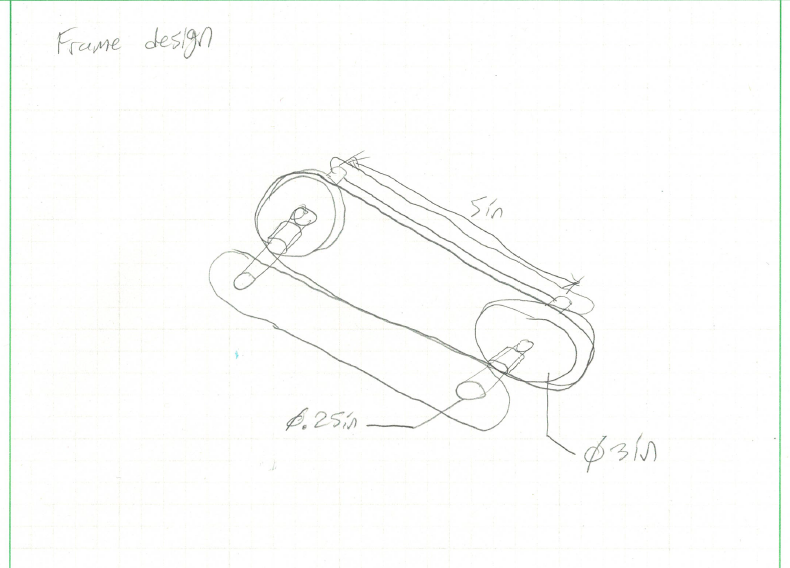

# A9 – Pulleys

## Objective
The objective of this design is to create a pully system in which we are given several parameters. The limitations of the design are that the axes of the pulleys are separated by 5 inches center to center. Each pulley has a diameter of 3 inches. The rotational speed will be 1500 rpm. the static belt tension will be 4 lb. of force. Our material will be made from aluminum and we will have a minimum safety factor of 3. Additionally our given belt is made from polyurethane rubber with a yield strength of 3.25 MPA (471 psi) at 20% strain. I will analyze and determine critical features such as the diameter of the belt, the journal bearings, and the frame.

## Analyze

### Belt due to stress
The first task in this assignment was to find the minimum diameter belt we needed for the pulley and select one from McMaster products that we could actually use. I wrote down all of my free variables and limited variables from the objective and information given. I drew a free body diagram of the pulley and made a cut to analyze one side. After writing the equilibrium equations I was able to find that when had two different tensional forces, which was expected but I was concerned with only the larger one for the analysis. Since it was an axial force I used the axial stress formula and applied a safety factor of three. I was able to find that the minimum area was 0.03397in^2. Solving for the minimum diameter my calculation came out to be 0.208in, and I rounded up to 0.25 inches. I also needed to find the outer circumference for the belt. using the diameter of a single pulley and the distance from center to center, I found the outer circumference to be 20.210 inches. I was able to find a suitable belt which can be seen below. The part number is 3044K606.

### Shaft diameter due to torque

The next thing to do was to find the minimum diameter of the shaft for the pulley's. A note here is we needed to calculate the minimum area when torque is applied to a shaft made out of 1060 hardened steel. I drew a free body diagram of the shaft, and solved for torque which came out to be 4lb*in. Using the shear stress due to torsion formula combined with the safety factor I was able to find the the yield strength/ 2*FS= T*c/J. Where J is for a solid cylindrical bar. I solved the previous equation for d and all I needed to do was solve for numerically. I needed the yield strength for 1060 hardened steel, so I went to page 421 of my machinery's handbook and found different yield strengths for different 1060 steels hardened at different temperatures. I decided to go with hardened 1060 steel at 1200 degrees fahrenheit, which gave me a yield strength of 76ksi. Finally plugging in our values, that gave us a minimum diameter of 0.117in, which was rounded to 0.25 inches.

## Decide

### Pressure and material
Next I needed to design the Journal Bearing for the shaft. I drew a free body diagram of the shaft with the bearings. I set up my equations for Bearing Pressure, Bearing Surface Velocity, and Pressure-Velocity Rating. For bearing pressure I found it to be 32psi, for the bearing surface velocity I found it to be 98.175 ft/min. With these two values I was able to calculate the pressure velocity rating, the product of the two came out to be 3141.6 psi*ft/min. I then went to page 2442 of my machinery's handbook at analyzed table 4 for a suitable material. I settled on dry graphite witch had a bearing pressure max of 600psi, the surface velocity max was 2500fpm, and the PV limit was 15,000 psi*ft/min. All three values are within our range of allowable values.

### Frame
Lastly, I drew a frame design for which the pulley, shaft, and bearing could be mounted onto. I gave a couple quick dimension for what I was thinking. I tried to utilize the frame concept from appendix A and create more rigidity by placing a plate on both sides. I guess depending on the mounting orientation the secondary plate may or may not be needed.

## Communicate

### Lessons learned
In this assignment I learned that we can take relatively simple and complex systems and apply concepts for statics and solid mechanics to better design as system as a engineer for multiple different things such as geometry, strength, functionality, and much more. I also learned that there is a ton of different ways to approach the workflow, not everything has to be known or given. as long as we have some bits of information, we can ask questions and use engineer judgement to make informed decisions. 

